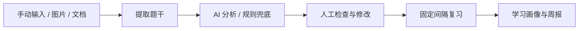

# MistakeMind

**把错题整理成可确认的分析结果和可执行的复习计划。**

面向考研 408 与数学一的单用户学习工具：输入题目、答案和自己的错误过程，获得知识点、错因及复习建议，经人工确认后生成复习任务，并查看学习画像和导出周报。

项目围绕个人备考需求进行 AI 辅助开发，同时将大模型接入实际学习流程。技术栈为 **Python · FastAPI · Jinja2 / HTMX · SQLAlchemy · SQLite**。

[启动与配置](docs/usage.md) · [AI 工作流](docs/ai-workflow.md) · [验证记录](docs/validation.md)

## 一次完整的使用流程



| 环节 | 当前能力 |
| --- | --- |
| 录入 | 手动输入、图片、文本、PDF 和 Word；保存来源文件 |
| 多模态提取 | 视觉模型 OCR，再用文本模型修正；扫描 PDF 可渲染为图片识别 |
| 错因分析 | 知识点、错因类型、难度、置信度、归因摘要、变式题及复习建议 |
| 人工确认 | 编辑题干和分析结果，低置信度时提示复核，确认后进入复习流程 |
| 复习 | 按 0、1、3、7、14 天生成任务，记录完成情况 |
| 画像与报告 | 学科独立的知识点统计、错因分布、趋势、复习完成率及 Markdown / PDF 周报 |

## AI 应用的实现重点

- **把模型输出接到业务数据中**：给模型提供学科知识点与允许的错因类型，要求 JSON 输出，再对字段做匹配、范围限制和默认值处理。
- **保留用户决定权**：模型先生成建议，用户修改、确认后再创建复习任务。
- **处理失败路径**：未配置 API 或分析失败时使用关键词与规则；图片无法识别时进入人工补充流程。
- **记录模型选择**：支持自动选择和手动指定模型，记录分析使用的模型与模式；显式配置候选列表时可顺序尝试。
- **两阶段 OCR**：视觉提取与文本修正分开；修正失败时保留原始 OCR 文本。

实现入口：[模型客户端](app/ai.py)、[文件提取](app/extractors.py)、[分析与确认](app/services.py)、[数据模型](app/models.py)。

当前实现使用提示词约束和应用侧字段规范化，并未使用服务端严格 JSON Schema 输出模式。知识组织采用三级知识点树与关键词匹配；复习间隔固定，尚未按个人表现自适应。详细流程和边界见 [AI 工作流](docs/ai-workflow.md)。

## 快速启动

在项目目录使用 PowerShell：

```powershell
.\start.ps1
```

或手动创建环境：

```powershell
python -m venv .venv
.\.venv\Scripts\python -m pip install -r requirements.txt
.\.venv\Scripts\python -m uvicorn app.main:app --host 127.0.0.1 --port 8000
```

浏览器打开 `http://127.0.0.1:8000`。首次启动会初始化数据库与基础知识点。

不配置 API Key 时可以体验规则分析、人工确认、复习与报表。要启用 AI，将 `.env.example` 复制为 `.env`，配置兼容的接口地址、密钥以及文本/视觉模型；密钥保留在本地。

```dotenv
AI_BASE_URL=https://your-provider.example/v1
AI_API_KEY=replace-with-your-key
AI_MODEL=your-text-model
AI_VISION_MODEL=your-vision-model
```

图片识别需要支持图片输入的模型。自动模型选择依赖服务端模型列表和名称启发式，建议按供应商实际支持情况显式配置。配置细节、Docker、调度与导出命令见[使用说明](docs/usage.md)。

## 演示与测试

建议在独立副本中生成示例数据，避免混入自己的错题库：

```powershell
.\.venv\Scripts\python -m app.cli seed-demo
.\.venv\Scripts\python -m pytest -q
```

推荐演示顺序：选择学科 → 录入错题 → 查看与修改分析 → 确认 → 查看复习任务 → 学习画像 → 导出周报。规则模式演示应明确标注；AI 模式可使用自编题目演示真实调用结果。

2026-11-04，在隔离副本中完成 **14 项测试，全部通过**。覆盖录入确认、学科隔离、文档导入、复习、报告、模型指定、低置信度提示和 OCR 修正。测试中的 AI 分支使用模拟响应，尚未进行真实模型准确率评测，见[验证记录](docs/validation.md)。

## 目录结构

```text
app/ai.py          模型选择、提示词、兼容接口与响应解析
app/extractors.py  图片、PDF、Word 与文本提取
app/services.py    分析规范化、规则兜底、人工确认与复习计划
app/templates/    Jinja2 页面与 HTMX 交互
app/reports.py     周报与 PDF 导出
app/scheduler.py   定时生成复习清单和周报
alembic/           数据库迁移
tests/             应用流程测试
docs/              配置、AI 工作流和验证记录
```

## 当前边界

项目定位为本机单用户应用。错因与置信度是辅助建议，不是经过校准的诊断或正确率承诺；题目、答案及变式题需要人工核对。启用 AI 后，相关题目文本或图片会发给所配置的模型服务。

仓库排除本地密钥、运行数据库和用户上传文件。项目级许可证尚未设置；第三方依赖遵循各自许可证。
